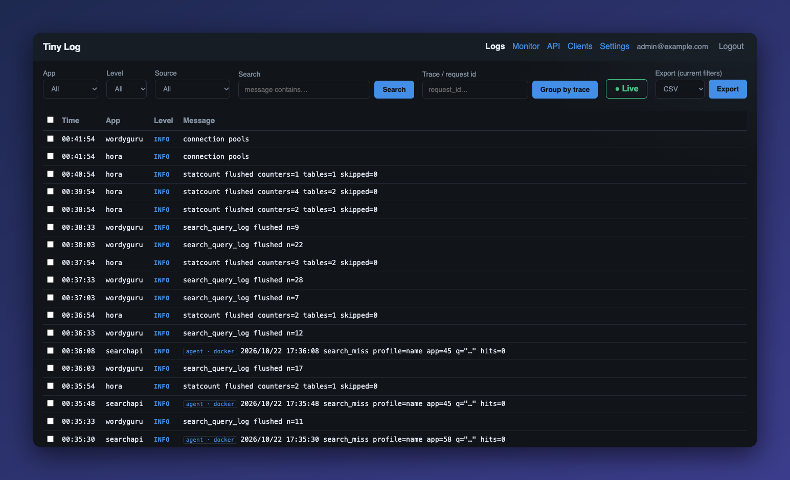
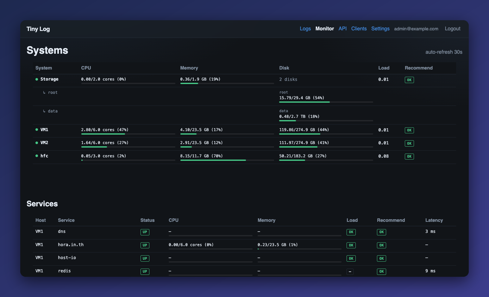

# Tiny Log

Lightweight, self-hosted centralized logging **and** host/service monitoring.
One Rust binary, one container, a few SQLite files, a vanilla-JS web UI. No Postgres, no Elasticsearch, no Kafka.

> Logging-focused by design — not an APM platform.





## Features

- **Log ingest** over HTTP (single + batch), with levels, app name, source, trace id and free-form `meta`
- **Web UI**: search/filter, keyset paging through older logs, live tail via SSE, export, trace view
- **Monitor overview**: CPU / memory / disks / load per host, service up/down + latency, capacity hints (`ok | watch | scale_out | limit`)
- **Agent** (Rust, ~tiny) for Docker hosts and bare-metal Linux:
  - host samples, multi-disk, disk-usage warnings
  - service checks: `http`, `tcp`, `process`, `mysql_status`, `dns`, `host_io`
  - Docker auto-discovery via container labels, container stats
  - log shipping from files and Docker containers (include/exclude regex, rate limit)
- **Client libraries**: Go, Node (ESM), browser JS
- **Retention** (default 30 days), admin account with Argon2 password, anonymous or login auth mode
- OpenAPI spec + Swagger UI served by the server

## Repository layout

| Path | What |
|---|---|
| `server/` | Axum + SQLx + SQLite server, web UI (`server/web`), migrations |
| `agent/` | Monitoring/log-shipping agent (Docker image + bare-metal systemd package) |
| `clients/go/` | Go client |
| `server/web/tinylog.mjs`, `tinylog.js`, `tinylog.go` | Node / browser / Go client files served by the server |
| `scripts/` | Build and push scripts (server image, agent image, agent Linux binary) |
| `Tiny Log — Final Technical Specification v1.0.md` | Design spec |

## Quick start — server

```bash
cd server
cp .env.example .env        # set TINY_LOG_API_KEY and TINY_LOG_CLIENT_TOKEN
docker compose up -d
```

Open `http://<host>:3006` and create the admin account on first visit.
The compose file uses the public image `kittipongint/tiny-log:1.0.0`
(Docker Hub, `linux/amd64` and `linux/arm64`). Data lives in `TINY_LOG_DATA_PATH` (default `./tiny-log-data`).

To build the image yourself instead: `scripts/build-server.sh` (tags `tiny-log:<version>`; point `image:` at it).

Key settings (env):

| Variable | Default | Notes |
|---|---|---|
| `TINY_LOG_PORT` | `3006` | |
| `TINY_LOG_API_KEY` | required | Bearer key for servers/agents sending logs & metrics |
| `TINY_LOG_CLIENT_TOKEN` | required | Public-ish token for browser clients |
| `TINY_LOG_AUTH_MODE` | `login` (code default) | `anonymous` or `login` — the example compose sets `anonymous`; use `login` on anything exposed |
| `TINY_LOG_RETENTION_DAYS` | `30` | |
| `TINY_LOG_SESSION_DAYS` | `7` | |
| `TINY_LOG_COOKIE_SECURE` | `false` | set `true` behind TLS |

Put it behind TLS (an nginx example is in `server/nginx/conf.d/tiny-log.conf`).

### Build from source

```bash
cd server && cargo build --release      # needs Rust 1.98+
```

## Send logs

```bash
curl -X POST http://localhost:3006/api/v1/logs \
  -H "Authorization: Bearer $TINY_LOG_API_KEY" \
  -H "Content-Type: application/json" \
  -d '{"app":"api","level":"error","message":"payment failed","meta":{"order":42}}'
```

Batch: `POST /api/v1/logs/batch`. Browser: `POST /api/v1/client/logs` with the client token.
Full API: `/swagger.html` on your server (spec at `server/web/openapi.json`).

### Client libraries

```go
c := tinylog.New(tinylog.Config{BaseURL: "https://logs.example.com", APIKey: key, App: "api"})
c.Log(ctx, tinylog.Error, "payment failed", map[string]any{"order": 42})
```

```js
import { TinyLogClient } from "./tinylog.mjs";
const log = new TinyLogClient({ baseUrl, apiKey, app: "worker" });
```

```html
<script src="https://logs.example.com/tinylog.js"></script>
<script>new TinyLogBrowser({ baseUrl: location.origin, clientToken: "…", app: "web" });</script>
```

## Agent

Set `TINY_LOG_URL` and `TINY_LOG_API_KEY` (same key as the server). Two ways to run it:

### Docker

Image: `kittipongint/tiny-log-agent:1.0.0` (Docker Hub, `linux/amd64` and `linux/arm64`, Alpine, tiny).
To build it yourself: `scripts/build-agent.sh`.

```bash
cd agent
cp .env.example .env     # TINY_LOG_URL, TINY_LOG_API_KEY, TINY_LOG_HOST_NAME
docker compose up -d
```

Mounts `/var/run/docker.sock` read-only. Monitor and ship logs from any container with labels:

```yaml
labels:
  tiny-log.monitor: "true"
  tiny-log.service: "mysql"
  tiny-log.logs: "mysql"                       # ship stdout/stderr as app "mysql"
  tiny-log.logs.include: "(?i)error|warn"
```

See `agent/docker.example.toml` and `agent/docker-compose.example.yml` for a full stack.

### Linux (bare-metal, systemd)

Pre-built **glibc `linux/amd64` / `linux/arm64`** package on the [Releases](../../releases) page
(Debian/Ubuntu and similar distros with systemd):

```bash
tar xzf tiny-log-agent-1.0.0-linux-amd64.tar.gz
cd tiny-log-agent-1.0.0-linux-amd64
sudo ./install.sh https://logs.example.com <API_KEY> my-host
# edit /etc/tiny-log/agent.toml  (see bare-metal.example.toml), then:
sudo systemctl restart tiny-log-agent
```

Installs to `/usr/local/bin/tiny-log-agent`, config in `/etc/tiny-log/`, runs as an unprivileged
`tiny-log-agent` user. Remove with `./uninstall.sh`.

### Agent config

Environment gives the connection, `agent.toml` gives what to watch:

```toml
system_interval_secs = 60
service_interval_secs = 120
disk_warn_pct = 85

[[disk]]
name = "root"
path = "/"

[[service]]
name = "mysql"
kind = "mysql_status"            # connections / refused / slow queries
dsn_env = "TINY_LOG_MYSQL_DSN"   # DSN stays in env, never in the file

[[logs]]
app = "nginx"
file = "/var/log/nginx/error.log"
```

Every option is documented in `agent/agent.example.toml`.

## Releases & images

| Artifact | Where |
|---|---|
| Server image | Docker Hub `kittipongint/tiny-log:<version>` |
| Agent image | Docker Hub `kittipongint/tiny-log-agent:<version>` |
| Agent Linux package | GitHub Releases: `tiny-log-agent-<version>-linux-{amd64,arm64}.tar.gz` |

Pushing a tag `vX.Y.Z` runs [`.github/workflows/release.yml`](.github/workflows/release.yml), which builds and
publishes all of the above. The tag must match the `version` in `server/Cargo.toml` and `agent/Cargo.toml`.
Manual build scripts live in `scripts/`.

## Development

```bash
docker compose -f docker-compose.dev.yml up      # dev stack
cd server && cargo test                          # API tests
node scripts/smoke-clients.mjs                   # client smoke test
```

## License

[MIT](LICENSE)
